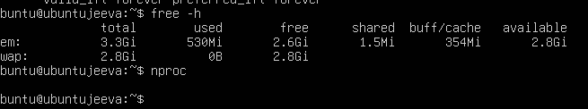
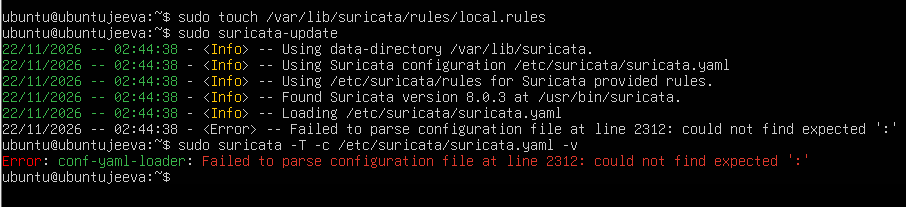
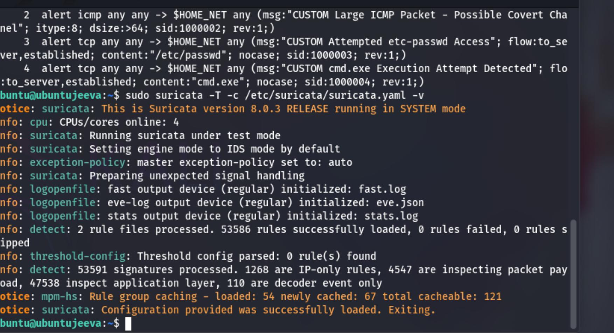
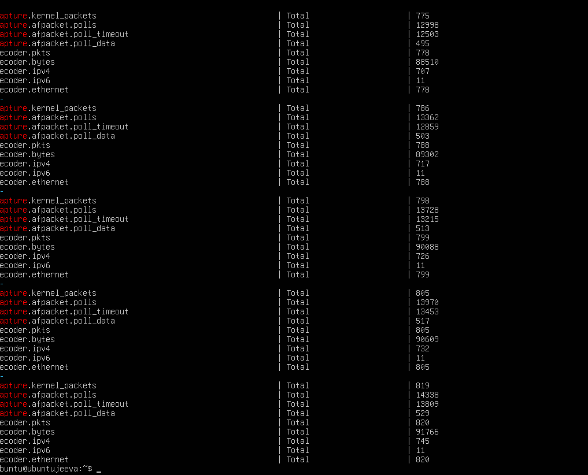
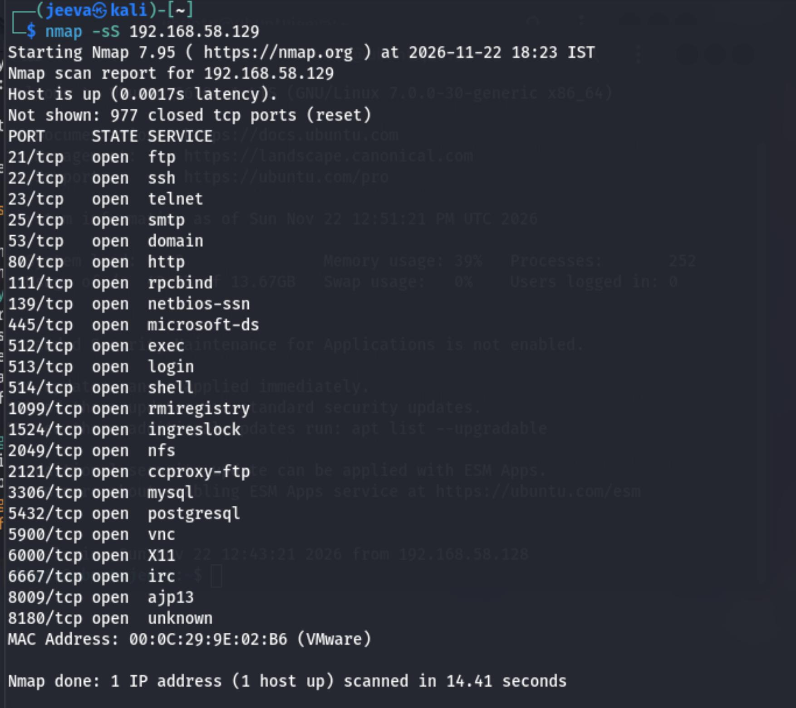
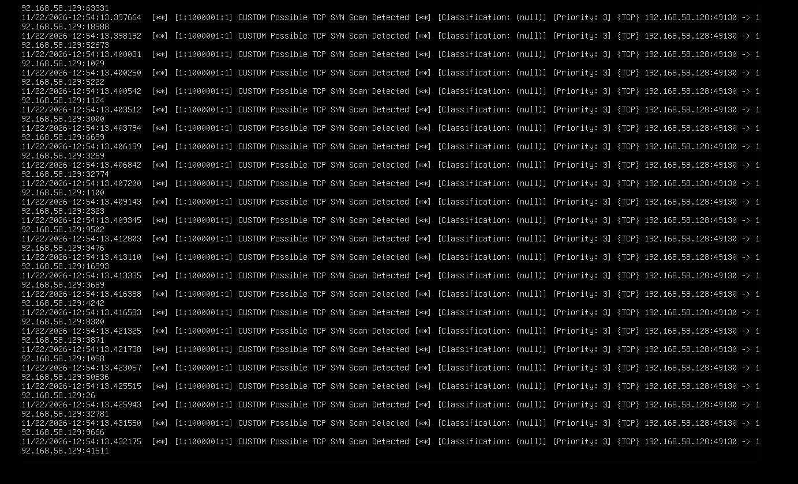
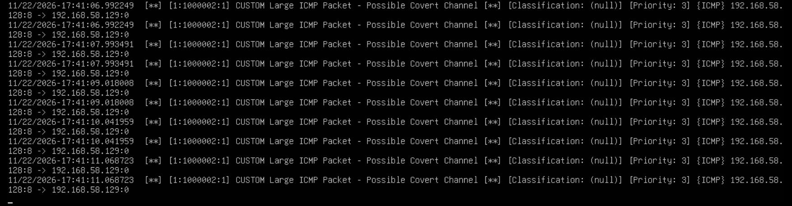
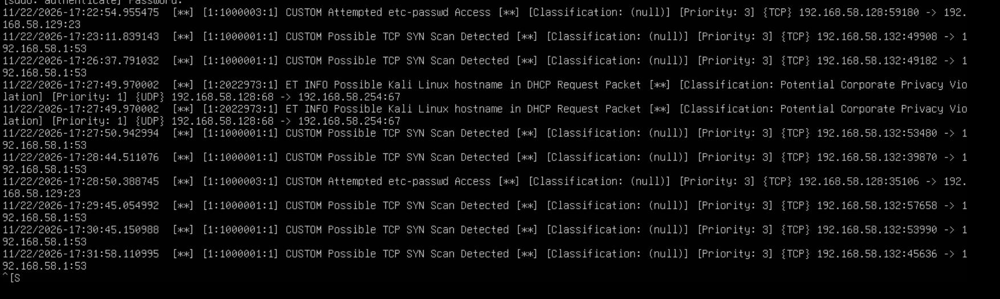
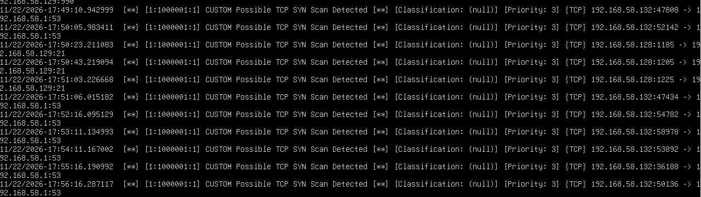
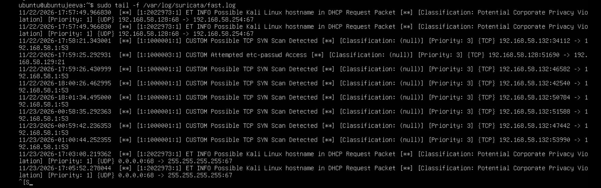

# Suricata IDS Evasion & Detection Engineering Lab

A hands-on cybersecurity project where I built a small, safe, private network with an attacker, a target, and a security sensor — then wrote my own detection rules, tested them with real attacks, tried to sneak past my own detection, and fixed a mistake I found along the way.

**Full written report:** [docs/IDS_IPS_Project_Report.docx](docs/IDS_IPS_Project_Report.docx)

---

## What This Project Is

Think of it like installing a CCTV camera with motion-detection rules, then hiring your own team to try sneaking past the camera, to find out if the rules have blind spots — and then fixing those blind spots.

I built three virtual machines:

| Machine | Role | IP Address |
|---|---|---|
| Kali Linux | Attacker | 192.168.58.128 |
| Metasploitable2 | Vulnerable target (a company server) | 192.168.58.129 |
| Ubuntu Server | Security sensor (runs Suricata) | 192.168.58.132 |

All three sit on one private, isolated network inside VMware, so nothing ever touches the real internet.

---

## What I Did, Step by Step

### 1. Built and connected the lab
I set up the Ubuntu sensor and confirmed all three machines could reach each other with a simple ping test.

### 2. Installed and configured Suricata
Suricata is the actual detection engine — it watches all network traffic passing by and raises an alert when something looks suspicious.

I hit a real error here: the configuration file failed to load because of a small spacing mistake (YAML, the file format Suricata uses, is very strict about this).

After fixing the spacing, it loaded cleanly:

I then confirmed the sensor was actually capturing live traffic by watching its packet counters climb in real time:

### 3. Wrote four custom detection rules

| Rule | What It Catches |
|---|---|
| Rule 1 | Someone scanning for open ports (common first step of an attack) |
| Rule 2 | An unusually large ping packet (can hide stolen data) |
| Rule 3 | Someone trying to read the Linux password file in plain text |
| Rule 4 | Someone sending "cmd.exe" (often a sign of remote command execution) |

The full rules are in [rules/local.rules](rules/local.rules).

### 4. Proved every rule actually works
I launched real (but safe, lab-only) attacks from Kali against Metasploitable2, and watched the alerts fire.

### 5. Tried to beat my own detection (evasion testing)
I tested two classic tricks real attackers use:

- **Breaking packets into tiny pieces** (IP fragmentation), using Nmap's `-f` and `--mtu 16` options
- **Sending data one byte at a time** (TCP segmentation), using a small Python script

**Result: both tricks failed.** Suricata's built-in packet reassembly put the pieces back together before checking them, so the evasion attempts were caught just as easily as a normal attack.

### 6. Found and fixed a real mistake
While Suricata ran in the background, I noticed my own port-scan rule was falsely firing on the sensor's own harmless DNS lookups.

My first fix attempt (excluding all "internal" traffic) accidentally broke real detection too, since the attacker was also "internal" in this lab. I corrected it with a more precise fix — excluding only DNS traffic (port 53) instead — which kept true detection working while silencing the false alarm.

---

## What I Learned

- A modern detection engine with packet reassembly turned on is genuinely resistant to classic fragmentation and segmentation evasion tricks.
- Writing a rule is easy. Writing a rule that doesn't also flag normal, harmless traffic is the harder and more valuable skill.
- Fixing one problem can accidentally create a new one if the fix is too broad — every fix needs to be tested from both directions.
- Detection engineering is not a one-time setup. It's a continuous loop of building, testing, attacking, and refining.

---

## Tools Used

Suricata 8.0.3 · Kali Linux · Metasploitable2 · Ubuntu Server 24.04 · VMware Workstation · Nmap · Python3 · FTP/Telnet

---

## Full Report

For the complete step-by-step writeup, including every command used and every challenge faced, see [Download Project Report (DOCX)](./IDS_IPS_Project_Report.docx)
